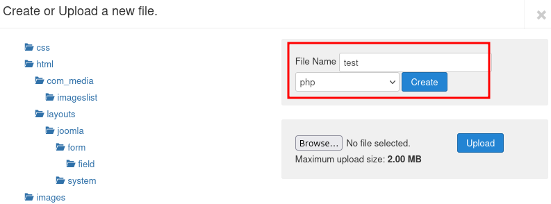

_____

Joomla! is a free and open-source content management system (CMS) for **publishing web content**

```bash
git clone https://github.com/droope/droopescan.git
cd droopescan
pip3 install -r requirements.txt
./droopescan scan --help
```


```bash
./droopescan scan joomla --url http://$IP
```

# Control panel 

/administrator/index.php

# Templates

/administrator/index.php?option=com_templates&view=templates

## Protostar

Create new file



/templates/protostar/test.php
