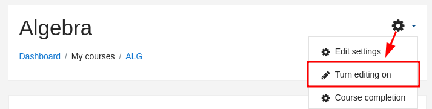
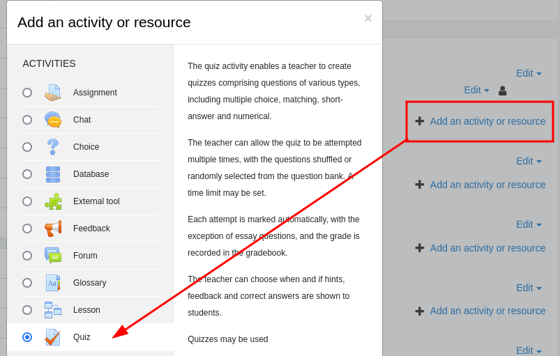
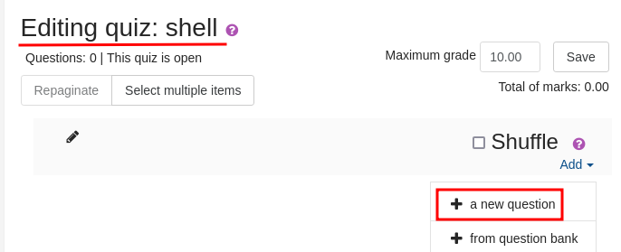
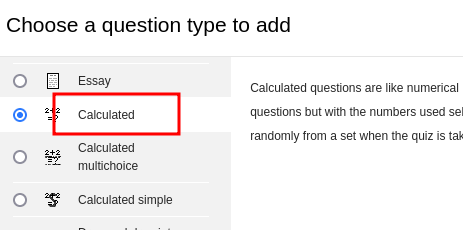
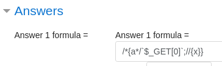

_____
Moodle is a Learning Management System (LMS) designed to provide educators, administrators and learners with a single robust, secure and integrated system to create personalised learning environments.

# Database

```
config.php
```

# CVE-2018-1133

https://blog.ripstech.com/2018/moodle-remote-code-execution/

https://0xdfimages.gitlab.io/img/teacher-rce.gif

```
/*{a*/`$_GET[0]`;//{x}}
```

Click the gear icon and “Turn editing on”,



“Add an activity or resource”, select Quiz, and hit “Add”



“Edit Quiz” button. I’ll click “Add” and then “a new question”. In the pop-up I’ll select “Calculated” and click “Add”. I’ll fill in all the required fields, but the only one that matters is the “Answer 1 formula”. In there I’ll add the string from exploit.






